# Capabilities

Status: **preliminary** (2026-10-27); phase 1 results added 2026-10-30.
Done means built and tested in phase 1 (`splectrum/dev-env-1-mycelium-git@33634de`).

The capabilities needed, by URI. Any activity that can be scripted is a
capability and goes on this list. Categories (first segment) are not yet
settled; neither is where functionality is stored. Code kept before
implementation sits in `capabilities/<uri>/`; reuse candidates are in
`capabilities/reuse.md`.

## Overview

Grouped by layer, from the base up; green done, amber built but not yet in
real use, blue the next phase, grey later.

```mermaid
flowchart BT
  subgraph base[Mycelium base layer]
    direction LR
    hc[Hypercore<br/>state/hyperdrive]:::next
    git[mycelium-git<br/>state/git · state/bundle]:::done
    avro[AVRO<br/>state/avro]:::later
    kafka[Kafka<br/>state/kafka]:::later
    voc[uri · xpath<br/>state/uri · state/xpath]:::done
  end
  subgraph para[Repository paradigms]
    direction LR
    layer[layer/create · deploy · extract<br/>import · export · request]:::done
    compose[layer/compose]:::later
    repo1[repo/seed]:::done
    repo2[repo/keep · inflate · ask<br/>publish · sync]:::built
    repo3[repo/promote · integrity · host]:::later
  end
  subgraph cluster[P2P cluster]
    direction LR
    env[env/sense · docker · udp<br/>node/deploy · run · teardown]:::next
    pkg[pkg/store · import · materialise]:::next
    cl[cluster/bootstrap · seed<br/>join · deployment]:::next
    op[op/chain]:::next
    p2p[p2p/discover · connect<br/>replicate · boundary]:::next
  end
  subgraph apps[Towards applications]
    direction LR
    dev[node/mobile · phone/loop]:::later
    data[data/*: instance · encrypt · pair<br/>keystore · blind · pq · session]:::later
    unit[unit/run · unit/iot]:::later
    ui[ui/serve]:::later
  end
  base --> para --> cluster --> apps
  classDef done fill:#2e7d32,color:#fff,stroke:#1b5e20
  classDef built fill:#f9a825,color:#000,stroke:#f57f17
  classDef next fill:#1565c0,color:#fff,stroke:#0d47a1
  classDef later fill:#9e9e9e,color:#000,stroke:#616161
```

## Prerequisites — first

| URI | Question it answers |
|---|---|
| `env/sense` | What does a node run on: runtime, host, container, cloud session, Docker? (probe ran 2026-10-27) |
| `env/udp` | Is outbound UDP available here? |
| `env/docker` | Is Docker usable, and how is its daemon started where needed? |
| `node/deploy` | Bring up one or more nodes, adapted to where it runs (now `cluster/*`, by operators) |
| `node/run` | Run nodes and collect their execution data (now `cluster/*`) |
| `node/teardown` | Remove what was deployed, leaving nothing behind |
| `phone/loop` | Get a real phone into the test loop and read its execution data |

## Repository

| URI | Question it answers |
|---|---|
| `repo/seed` | Create a repository from the seed template (done: mycelium-repo) |
| `repo/host` | Manage the repository on its host (GitHub): default branch, protection of `main` and the layer branches |
| `repo/integrity` | Check the repository keeps its rules: disjoint layers, plain merges, history only grows |
| `repo/sync` | Sync all layers to other remotes (e.g. Codeberg): plain pushes, report divergence (built: mycelium-repo, against stand-ins; ad hoc for now) |
| `repo/publish` | Split a folder package into `publish/<package>` and push it to its product repository's `execute/main` (built: mycelium-repo, against stand-ins; ad hoc for now) |
| `repo/keep` | Keep a repository as a bundle, its full record (built: test-run) |
| `repo/inflate` | Bring a kept repository back to ask it again (built: test-run) |
| `repo/ask` | Put a request into a repository, run it, read the response (built: test-run) |
| `repo/promote` | Deploy a tested capability tree into `capability/default`, with its evidence |

## State

| URI | Question it answers |
|---|---|
| `state/git` | Keep all node state in git; isomorphic-git or custom? (done: mycelium-git) |
| `state/uri` | Our URIs: parse, validate, split at known prefixes (done: mycelium-uri) |
| `state/xpath` | Navigate a tree by path, generic (done: mycelium-xpath) |
| `state/bundle` | Write and read git bundles on every engine (done: mycelium-git) |
| `state/hyperdrive` | Git on Hyperdrive: p2p-git, Corestore, a replicated store |
| `state/avro` | Objects as typed data: schemas and typed values, a URI naming a value |
| `state/kafka` | Streams and high-volume data: topics and partitions on Hypercore |

## Layers

A layer on top of git (native or isomorphic) that gives the required
behaviour; everything above uses it, never git directly.

| URI | Question it answers |
|---|---|
| `layer/create` | Create a layer branch, orphan, under a reserved first segment (done: mycelium-git) |
| `layer/deploy` | Deploy a folder package into a layer, as a commit referencing its source (done: mycelium-layer) |
| `layer/extract` | Extract a layer into a folder package, recording its provenance (done: mycelium-layer) |
| `layer/compose` | Build a composed view: `main` with its layers, local, imported or virtual |
| `layer/import` | Pull a layer in from another repository, with its history (done: mycelium-layer) |
| `layer/export` | Push a layer out to another repository (done: mycelium-layer, as bundles) |
| `layer/request` | The request flow: `pending/default`, `execute/main`, merge into `main` with references (done: mycelium-layer, intake and execution) |

## Cluster

The next phase: the creation of a P2P cluster (`vision.md`).

| URI | Question it answers |
|---|---|
| `pkg/store` | Keep packages once, in a package repository, each instance a commit |
| `pkg/import` | Bring a third-party package in once, at the boundary |
| `pkg/materialise` | Resolve a deployment's links into the folders Node and Bare expect |
| `cluster/bootstrap` | A bootstrap repository that sets up a node from a plain base with Bare only |
| `cluster/seed` | Bring up the seed node, the first always-on peer |
| `cluster/join` | Bring further nodes into the cluster |
| `cluster/deployment` | A deployment repository: what the cluster is, its nodes, state and monitoring |
| `op/chain` | Run a multistep process as a chain of single-concern operator repositories |

## Units

| URI | Question it answers |
|---|---|
| `unit/run` | Run a self-contained unit on a node: start, stop, audit |
| `unit/iot` | Manage IoT devices from a unit |

## UI

| URI | Question it answers |
|---|---|
| `ui/serve` | Serve a browser UI locally from every node, with no dependency on another |

## Nodes on devices

| URI | Question it answers |
|---|---|
| `node/mobile` | Run a full peer on a phone: Bare in an app, or Termux? |

## P2P

| URI | Question it answers |
|---|---|
| `p2p/discover` | Find the owner's other nodes |
| `p2p/connect` | Connect nodes, with a phone on mobile data as the hard case: holepunching, home node, VPS, Cloudflare at the edges |
| `p2p/replicate` | Replicate state between nodes |
| `p2p/boundary` | Where git's fetch and push give way to subscription and replication |

## Private data

| URI | Question it answers |
|---|---|
| `data/instance` | Keep a unit's private instance data in its own repository |
| `data/encrypt` | Encrypt instance repositories (Holepunch, or age/sops on git meanwhile) |
| `data/pair` | Pair the owner's devices, keys moved out of band |
| `data/keystore` | Where a device's primary key is kept |
| `data/blind` | An always-on blind peer for availability |
| `data/pq` | Post-quantum readiness of key exchange |
| `data/session` | How a cloud session gets the private data it needs, and whether an AI session can act as operator |

## Sequence

Done: state and layers, the repository capabilities on stand-ins (phase
1). Next: the cluster, starting with p2p-git on Hyperdrive. What follows
depends on its outcome; the rest of the list is input, not an order.
